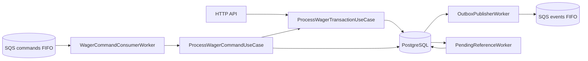

# Architecture — Distributed Wagering Processor

**Versão da análise:** 16/11/2026. Documento baseado nos arquivos do branch público `main` consultados nessa data e nos resultados de testes fornecidos pelo mantenedor. Itens não comprovados estão explicitamente identificados como limitações ou pontos de validação.

## 1. Objetivo e premissas

Processar comandos financeiros de provedores de jogos sob entrega *at-least-once*, concorrência entre instâncias e falhas temporárias de PostgreSQL/SQS, mantendo: sem débito/crédito duplicado, saldo não negativo, histórico auditável e eventos confirmados publicáveis após commit.

A consistência financeira é responsabilidade do **PostgreSQL**, não da ordem ou deduplicação do broker. A unidade de contenção é a wallet, não um lock global. A implementação adota NestJS/Bun/TypeScript, MikroORM e SQS FIFO/LocalStack.

## 2. Visão arquitetural



- **Domain:** `Money`, `Wallet`, `WalletLedgerEntry`, `WagerTransaction`, `InboxMessage`, `OutboxMessage`, eventos de integração. A criação/rehydration encapsula as regras de domínio e a mutabilidade é controlada.
- **Application:** casos de uso de abertura de wallet, processamento de transação, comandos SQS, retry de referências, reconciliação e publicação da Outbox.
- **Infrastructure:** repositories MikroORM/SQL, SQS SDK, cron workers e controllers NestJS.
- **Transport:** HTTP e SQS reutilizam `ProcessWagerTransactionUseCase`; entrada SQS adiciona deduplicação por Inbox na transação externa.

**Ponto importante:** `api` e `worker` inicializam o mesmo módulo NestJS na configuração Compose consultada; portanto cada réplica pode executar cron jobs e, no caso da API, também expor rotas HTTP. A separação de papéis ainda é uma evolução recomendada.

## 3. Dinheiro: representação exata

`src/shared/domain/money.ts` representa valores por **`bigint` em centavos** e armazena o código de moeda como string de três letras maiúsculas. Não usa `number`, `float` ou `double` para a aritmética monetária. `Money.fromDecimal('25.00','BRL')` cria o valor; soma/subtração produzem novas instâncias; operações entre moedas distintas falham; `toDecimalString()` serializa com duas casas.

A factory admite uma ou duas casas na entrada e normaliza a saída para duas. Strings negativas são permitidas dentro do value object (necessárias à aritmética), mas são rejeitadas nos contratos de apostas; valores de apostas iguais a zero também são rejeitados. A entrada aceita espaço externo por aplicar `trim()` — diferença pequena em relação à regra estrita de formato do enunciado que deve ser tratada conscientemente. A expressão regular rejeita notação científica e excesso de casas.

Persistência utiliza valores decimais serializados e moeda separada, reidratando a representação exata no domínio. Os limites de precisão da coluna SQL precisam ser compatíveis com o maior montante admitido pela aplicação.

**Trade-off:** `bigint` com escala fixa é simples, preciso e adequado às 2 casas exigidas; não é uma implementação genérica de escalas ISO-4217 variáveis.

## 4. Wallet e ledger

- Cada wallet corresponde a um jogador e uma moeda; a unicidade deve ser protegida no schema.
- A wallet rejeita alterações que levem a saldo negativo.
- Uma wallet com saldo inicial positivo gera `OPENING` interna, entrada `CREDIT` e eventos correlatos na mesma transação SQL (`CreateWalletUseCase`).
- `BET` debita; `WIN` credita; `LOSS` registra resultado sem alterar saldo; `REFUND` credita uma BET válida; `ROLLBACK` aplica o inverso da referência permitida.
- Operações aplicadas que alteram saldo produzem uma entrada de ledger com `balanceBefore` e `balanceAfter`. Um ledger de partidas dobradas não é exigido no desafio.
- `REJECTED` não cria movimentação financeira; `LOSS` não cria lançamento.
- `version` da wallet sinaliza alterações de saldo, não toda mudança no agregado.

Invariante a observar nos testes e na reconciliação:

```text
wallet.balance = SUM(ledger CREDITS) - SUM(ledger DEBITS)
```

A reconciliação (`POST /wallets/:id/reconciliation`) informa diferença e consistência sem alterar silenciosamente o saldo.

## 5. Concorrência e transações SQL

`ProcessWagerTransactionUseCase` abre uma transação MikroORM e bloqueia a wallet por `WalletRepository.findByIdForUpdate(walletId, tx)`. Isso serializa operações financeiras concorrentes sobre a mesma wallet através do banco, sem lock global de aplicação. O efeito financeiro, ledger, transação e eventos Outbox são persistidos no mesmo contexto transacional. Para comandos SQS, o caso de uso recebe o `EntityManager` da transação que inclui a Inbox.

**Vantagens:** o lock funciona entre processos e containers, evita lost update da mesma wallet e permite paralelismo para wallets distintas. **Custos:** hot wallets podem ter fila de espera e maior latência; deadlocks, timeout e indisponibilidade do banco precisam ser classificados e tratados operacionalmente.

Cenário de aceitação exigido: `100.00 BRL` com duas BETs de `80.00` simultâneas deve resultar em uma `PROCESSED`, uma `REJECTED` com `INSUFFICIENT_FUNDS`, saldo `20.00`, um débito no ledger e nenhum segundo efeito após replay.

A suíte informada pelo mantenedor passou um teste de 50 BETs idênticas concorrentes. Ainda é necessário demonstrar pelo menos três processos reais, colisão de apostas distintas e crash recovery.

## 6. Idempotência persistente

A API exige o cabeçalho `Idempotency-Key`. O hash do payload de negócio é SHA-256 aplicado a `JSON.stringify` de um objeto criado em ordem estável de campos (`src/wagering/application/wager-payload-hash.ts`), com valor monetário normalizado para duas casas e referência ausente como `null`. O header não integra o hash.

No processamento, uma transação já existente para `(providerId, idempotencyKey)` é comparada ao hash do payload. Mesmo hash retorna resultado persistido e sinaliza `idempotentReplay: true`; hash divergente produz conflito. A busca do resultado anterior inclui o saldo observado naquele momento, não necessariamente o saldo atual da wallet.

A Inbox usa `(consumerName, messageId)` como fronteira de deduplicação de comandos. O corpo bruto também recebe SHA-256 para identificação de conflito entre mensagens com o mesmo ID e conteúdos distintos. A deduplicação financeira por provider/key continua necessária mesmo que a mensagem receba um novo `messageId`.

**Banco como fonte de verdade:** confirmar também nas migrations/constraints os índices únicos correspondentes; o lock e as buscas em código, isoladamente, não substituem constraints.

## 7. Transações e reversões

Estados: `PENDING`, `PENDING_REFERENCE`, `PROCESSED`, `REJECTED`, `FAILED`. Estados `PROCESSED`, `REJECTED` e `FAILED` são terminais. A reidratação de estado persistido não deve repetir validação de transição de negócio.

| Operação | Efeito | Condição principal |
|---|---|---|
| `OPENING` | Crédito inicial | Uso interno exclusivamente |
| `BET` | Débito | Saldo suficiente |
| `WIN` | Crédito | Contexto de rodada/jogador válido |
| `LOSS` | Sem movimentação | Resultado registrado |
| `REFUND` | Crédito | Referência a BET processada, mesmo contexto |
| `ROLLBACK` | Inversão de efeito | Referência permitida e saldo resultante não negativo |

`REFUND` e `ROLLBACK` exigem `referenceExternalTransactionId`; a resolução usa provider e ID externo. As restrições de referência devem assegurar mesmo provider, player, wallet, moeda e rodada, além de mesmo valor, reversão única por tipo e ausência de ciclo. No modelo constam códigos como `INSUFFICIENT_FUNDS`, `INVALID_REFERENCE`, `REFERENCE_NOT_FOUND` e `REVERSAL_WOULD_OVERDRAW`, permitindo distinguir falhas funcionais.

Referências ausentes podem persistir como `PENDING_REFERENCE`, posteriormente revisitadas pelo `PendingReferenceWorker` agendado a cada 5 segundos. Política exata de tentativas, backoff e TTL deve ser conferida em `RetryPendingReferencesUseCase` e explicada durante a apresentação; não é seguro inferir esses números apenas do agendamento do worker.

## 8. SQS, Inbox e reconhecimento

Há um consumidor periódico (`WagerCommandConsumerWorker`), que consulta a fila a cada 5 segundos e recebe uma mensagem por ciclo com long polling de 10 segundos e visibilidade de 60 segundos. O payload é validado por `ProcessWagerCommandUseCase` e processado sob a mesma transação que registra a Inbox. Somente **depois** do processamento bem-sucedido o consumer chama `DeleteMessage` para reconhecer a mensagem.

Em falha de processamento, não é feito ACK, permitindo redelivery. Em falha de ACK após commit, Inbox/idempotência impedem novo efeito financeiro. O parser aceita o envelope `commandType: 'ProcessWagerTransaction', schemaVersion: 1` e mantém compatibilidade com o envelope legado `type: 'WagerTransactionRequested'` que contenha `occurredAt` válido.

**Limitação identificada:** o consumer atual trata erros genericamente (registra e não reconhece). Não foi demonstrada no código do consumer uma taxonomia completa de erros de negócio terminais, transitórios e permanentes, nem a garantia de DLQ/redrive configurado. A estratégia de retry/DLQ depende da criação e política das filas; deve ser validada em LocalStack com comportamento real. `enableShutdownHooks()` está ativado, mas a conclusão/devolução de mensagens em voo durante SIGTERM requer um teste dedicado.

## 9. Transactional Outbox

Eventos financeiros são registrados na Outbox **antes do commit**, sem envio direto ao SQS durante a transação financeira. `OutboxPublisherWorker` roda a cada 5 segundos, chama `PublishOutboxUseCase` e publica na fila de eventos.

O repository usa `FOR UPDATE SKIP LOCKED` para reivindicar mensagens elegíveis, um token de lease e expiração de **120 segundos**. A query também impede publicação de evento posterior do mesmo agregado quando existe evento anterior pendente. Após o `SendMessage` ao SQS, `confirmPublished` verifica o token e marca `published_at`; falhas acionam `schedulePublishRetry`.

Essa estratégia tolera a morte do processo após o commit financeiro e antes da publicação. No intervalo entre publicar no SQS e confirmar `published_at` no banco, uma mensagem pode ser reenviada: entrega **at-least-once**, não exactly-once fim a fim. O evento usa `aggregateId` como `MessageGroupId` e o ID da Outbox como deduplication ID; consumidores precisam ser idempotentes mesmo assim.

Eventos de integração mínimos previstos: `WagerTransactionProcessed`, `WagerTransactionRejected`, `WalletBalanceChanged` (somente quando saldo muda) e `WagerTransactionPendingReference`. O payload usa strings para valores monetários.

**Limitação:** o comportamento dos leases deve ser exercitado com dois publishers reais e falhas no ponto entre envio SQS e confirmação SQL; testes unitários com erro simulado não substituem esse cenário.

## 10. Banco de dados e garantias em schema

A solução utiliza PostgreSQL 17 (imagem Compose) com MikroORM e migrations versionadas. O desafio exige aplicação **no schema**, não apenas nas classes, de:

- unicidade `(player_id, currency)` da wallet;
- unicidade de idempotência por provider/key e ID externo por provider;
- unicidade de lançamento por wallet/transação;
- `CHECK` para saldo não negativo e montantes válidos;
- imutabilidade dos registros do ledger, inclusive contra `UPDATE` e `DELETE`;
- integridade de referências e índices de consulta/retry/outbox.

O código inclui testes de integração de imutabilidade do ledger e criação de wallets; porém a matriz completa de constraints precisa ser reconciliada com a última migration antes da entrega. O compromisso arquitetural é que essas garantias não dependam apenas de verificações na API.

## 11. API e observabilidade

Endpoints verificados: `POST /wallets`, `GET /wallets/:id`, `GET /wallets/:id/ledger` (cursor estável, com offset legado), `POST /wallets/:id/reconciliation`, `GET /wallets/reconciliation`, `POST /wagering/transactions`, `GET /health/live`, `GET /health/ready` e `GET /internal/health`. O módulo de consulta a transações existe, mas seus parâmetros devem ser conferidos diretamente no controller específico antes de publicar exemplos.

Liveness não acessa dependências; readiness testa `SELECT 1` e `GetQueueAttributes` de ambas as filas, devolvendo indisponibilidade quando necessário. O endpoint operacional retorna volume aproximado de mensagens SQS e contadores da Outbox (`pending`, `waitingRetry`, `activeLeases`, `failedAttempts`).

**Gap a fechar:** métricas completas exigidas (transações por status, duplicatas, retries, DLQ, lock conflicts, outbox lag e latência) e logs **estruturados em JSON** com `correlationId`, `messageId`, `transactionId`, `walletId` e `providerId` sem payload financeiro completo. Logs NestJS atualmente visíveis nos testes não comprovam esse contrato integral.

## 12. Autenticação e fronteira de confiança

**Decisão de escopo:** não foi identificado IdP externo nem guard de autenticação nos controllers consultados. O desafio permite omitir autenticação, que não pontua, desde que a decisão seja documentada.

**Extensão proposta, ainda não implementada:** integrar OIDC (Keycloak/Zitadel), validar token em guard de entrada HTTP, extrair identidade do provider validada e associá-la ao `providerId` da transação; health continua público. Mensagens SQS trafegam em canal interno confiável, mas o `providerId` do payload continua sujeito às regras de domínio. Não criar autenticação própria com tabela de senha.

## 13. Testes, evidências e critérios de aceite

Em 16/11/2026, logs enviados pelo mantenedor registraram 119 testes unitários, 43 de integração e 22 E2E, todos aprovados (**184/184**). Entre os testes de integração, há cenário de **50 BETs concorrentes idênticas**, que passou. Foram rodados via `bun run test`, `test:integration` e `test:e2e`, com base `jungle_processor_test` para as duas últimas suítes.

**Ainda não demonstrado apenas por esses logs:** ≥3 processos competindo de fato, `SIGKILL` precisamente entre commit e ACK, dois publishers reais, DLQ real, e recuperação de serviço com reconciliação final. Esses ensaios devem manter o critério `wallet.balance == ledger reconstruído`.

## 14. Trade-offs e limitações explícitas

1. **Pessimistic locking por wallet:** simplicidade e segurança interprocessos em troca de contenção em wallets muito quentes.
2. **Ledger de entrada única:** satisfaz o desafio, mas não equivale a contabilidade de partidas dobradas.
3. **FIFO:** útil para ordenação e agrupamento, mas não é garantia final de idempotência nem elimina redelivery.
4. **Outbox at-least-once:** preserva eventos após commit, aceita duplicidade de publicação; consumidor idempotente continua necessário.
5. **Cron polling:** simples para o timebox, com latência de agendamento e throughput limitado por ciclo.
6. **Escala monetária fixa:** `bigint` em centavos atende às duas casas do desafio; moedas com outras casas exigiriam evolução do modelo.
7. **Autenticação não implementada:** escolha de escopo permitida, mas implantação pública não é adequada sem controle de acesso.
8. **Observabilidade parcial:** health e diagnóstico da Outbox existem; métricas e correlação estruturada ainda necessitam trabalho.
9. **DLQ/shutdown:** política e evidências de recuperação de falhas precisam ser finalizadas.
10. **Compose:** arquivo `dockerfile` versus `Dockerfile` exige correção no checkout Linux conforme o estado público consultado; fila LocalStack requer provisionamento.

## 15. Próximos passos priorizados

1. Corrigir build Docker e automatizar provisionamento de filas/DLQ no ambiente local.
2. Validar todas as constraints e migrations com integração PostgreSQL.
3. Implementar/comprovar política explícita de falhas, limites de tentativas e encaminhamento à DLQ.
4. Adicionar teste automatizado de kill após commit e antes de ACK, com três instâncias reais.
5. Demonstrar dois publishers concorrentes da Outbox e reconciliação após restart.
6. Completar observabilidade e evidências operacionais.
7. Fixar papéis de API e worker por entrypoint para reduzir duplicidade de loops HTTP/cron.

## 16. Referências de código (caminhos internos)

- `src/shared/domain/money.ts`
- `src/wallet/application/create-wallet.use-case.ts`
- `src/wallet/wallet.controller.ts`
- `src/wagering/domain/wager-transaction.ts`
- `src/wagering/application/process-wager-transaction.use-case.ts`
- `src/wagering/application/process-wager-command.use-case.ts`
- `src/wagering/application/wager-payload-hash.ts`
- `src/wagering/workers/wager-command-consumer.worker.ts`
- `src/wagering/workers/pending-reference.worker.ts`
- `src/messaging/application/publish-outbox.use-case.ts`
- `src/messaging/repositories/outbox.repository.ts`
- `src/messaging/workers/outbox-publisher.worker.ts`
- `src/messaging/infrastructure/sqs.service.ts`
- `src/observability/health.controller.ts`
- `docker-compose.yml`, `docker-compose.localstack.yml`, `migrations/`
